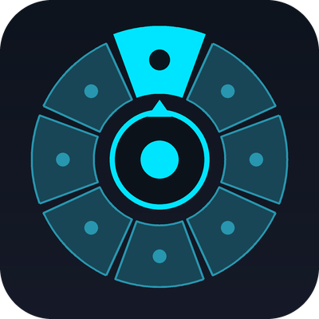

<p align="center"></p>

# CPM Wheel


-orange)
-blue)


Roda radial para organizar e tocar as animações do **[Customizable Player Models (CPM)](https://github.com/tom5454/CustomPlayerModels)**. Também traz:

- animações da mão em 1ª pessoa;
- ajustes de posição por item, grupo ou mod;
- física de itens pendurados;
- gatilhos automáticos com condições, transições e sons;
- **Física Live2D** para cabelo, cauda e asas, escrita nas camadas de valor do CPM, com prévia ao vivo, vento, impactos, olhar, voz e respiração/piscar;
- teclas de emotes, encadear animações e perfis automáticos por modelo;
- integração opcional com o **Emotecraft** (botão de emote, condição e física durante emotes).

Autor: **Zeraph**. Mod só de cliente: o servidor não precisa ter.

> Todas as telas do jogo estão em português (com tradução em inglês).
>
> **Capturas de tela:** ainda não há. As telas só existem dentro do Minecraft e não dá para gerá-las sem abrir o jogo; elas serão adicionadas em `docs/` quando forem tiradas no jogo.

---

## Sumário
- [Requisitos e instalação](#requisitos-e-instalação)
- [Recursos](#recursos)
- [Novidades da 1.8.0](#novidades-da-180)
- [Emotecraft (1.8.1)](#emotecraft-181)
- [Olhar e piscar (1.8.3)](#olhar-e-piscar-183)
- [Novidades da 1.9.2](#novidades-da-192)
- [Novidades da 1.9.1](#novidades-da-191)
- [Novidades da 1.9.0](#novidades-da-190)
- [Guia rápido: Física Live2D (cabelo)](#guia-rápido-física-live2d-cabelo)
- [Configuração e teclas](#configuração-e-teclas)
- [Compilar](#compilar)
- [Versões](#versões)
- [Limites conhecidos](#limites-conhecidos)
- [Licença e créditos](#licença-e-créditos)
- [English summary](#english-summary)

---

## Requisitos e instalação

| | NeoForge | Forge |
|---|---|---|
| Minecraft | 1.21.1 | 1.20.1 |
| Loader | NeoForge 21.1.x (compilado com 21.1.262) | Forge 47.x (compilado com 47.4.26) |
| Java | 21 | 17 |
| Jar | `cpmwheel-<versão>-neoforge-21.1.262.jar` | `cpmwheel-<versão>.jar` |

- **Customizable Player Models 0.6.0 ou mais novo**. No `mods.toml` ele é dependência opcional, mas sem o CPM a roda não tem animações para tocar.
- Instalação:
  1. Baixe o jar da sua versão em [Releases](https://github.com/wellinton523/cpm-wheel/releases).
  2. Coloque-o na pasta `mods` junto com o CPM.
  3. Abra o jogo e aperte **G** para abrir a roda.

---

## Recursos

### Roda de animações
- **Páginas** e **sub-rodas** (pastas). A página de favoritos (★) e o anel de favoritos/recentes são opcionais.
- **Tipos de botão:**
  - liga/desliga;
  - **valor** (slider ou presets em %);
  - **frames**;
  - **grupo** (várias animações de uma vez);
  - **condicional** (regras pelo item na mão);
  - tempo opcional em segundos para desligar sozinho.
- **Editor:** arraste animações da lista para os slots e arraste slots para reordenar. Cada botão tem:
  - nome, cor e ícone (id de item ou PNG próprio em `config/cpmwheel/icons/` como `file:nome.png`);
  - modo de exibição (ícone, texto ou os dois);
  - tecla própria, com aviso de conflito.
- O botão "Adicionar animações que faltam" preenche a roda com o que o modelo tem.
- Prévia ao passar o mouse (opcional, muda o modelo de verdade), atalhos Alt+1..9 e sons de clique com volume.
- **Bloqueio por gatilho:** um botão segurado por uma regra mostra um cadeado e não muda enquanto a regra está ativa.

### Estilos
- Designs: **Clássico, Neon, Minimalista, Vidro, Pétalas, Hexágono/Pixel, Terminal**.
- Cores: padrão do design, ciano, vermelho, roxo, verde, dourado e branco.
- Centro da roda: jogador, só ícone ou nada, com tamanho ajustável. Também dá para escolher só ícones e o tamanho dos ícones.

### Primeira pessoa: braço e animações da mão
- **"Renderizar braço como Better Combat (emissão)"** (ON / só com shader / OFF):
  - o braço em 1ª pessoa é desenhado junto com as entidades do mundo, como o Better Combat faz, então a emissão do CPM funciona com shaders;
  - "Profundidade do braço" puxa o braço para perto da câmera;
  - se der erro, volta sozinho ao método antigo naquela sessão;
  - enquanto o Better Combat anima os braços, o CPM Wheel pausa.
- **Brilho na mão** e **Mão 1ª pessoa** (padrão do CPM / segue camadas / segue tudo).
- **Animações da mão**, cada uma liga/desliga com intensidade em %:
  - respiração, balanço ao andar, inércia da câmera, pulo/aterrissagem, agachar, troca de item;
  - poses por item, variações de ataque, comer/beber, nadar/escalar;
  - braço visível com item, bloco com 2 mãos, lanterna/tocha.
- **Compatibilidade:** detecta Hold My Items, First Person Model, Real Camera, Better Combat e Eating Animation, com opção "Ignorar" para cada um.

### Itens na mão: ajustes, grupos e busca
- **Ajuste do item** por tipo (incluindo "bloco plano" para flores, portas etc.) e **Ajuste do braço**.
  - Cada ajuste tem X/Y/Z, giros e tamanho, por mão ou **igual nas duas mãos** (⇆).
- **Itens e mods…**: ajustes por **item**, **grupo** ou **mod inteiro**, tanto do item quanto do braço.
  - Prioridade: item > grupo > mod > tipo > padrão.
  - A tela mostra de onde cada valor é herdado. Também tem **Copiar p/…** e **↺ Herdado**.
- **Grupos de itens:**
  - a tela **"Criar grupo"** é passo a passo: mod, o que o nome deve ter, o que excluir e se conta o nome traduzido;
  - prévia com ícones, exemplos prontos e cor do grupo;
  - **Sugestões…** propõe grupos automáticos (mesmo final de id, classe ou tag);
  - o modo avançado aceita padrão com `*`/`?`, regex `re:`, tag `#c:...`, classe ou lista.
- **Sintaxe da busca** (também usada na condição "Segurando item"):

  | Escreva | Significa |
  |---|---|
  | `iron backpack` | espaço = E (precisa das duas palavras) |
  | `backpack \| mochila` | `\|` = OU |
  | `backpack -upgrade` ou `!upgrade` | tirar |
  | `@sophisticatedbackpacks backpack` | só desse mod (`@a\|b` para vários) |
  | `minecraft:lantern` | com `:` compara o id inteiro |

  Maiúsculas e minúsculas não importam. O nome traduzido pode contar, e nele o espaço vale como `_`.

### Física de pendurado
- O item balança na mão em 1ª pessoa como uma lanterna: ao virar a câmera, olhar para cima/baixo, andar, pular, cair, arrancar e parar.
- Funciona por item, grupo, mod ou tipo, com a mesma prioridade dos ajustes, por mão ou igual nas duas.
- **Ajustes:**
  - ponto de giro (alça ou topo);
  - intensidade, rigidez, amortecimento, peso e ângulo máximo;
  - reação a pulo/queda/parada;
  - **Seguir a gravidade** (0–100%) e **Limite: maior**;
  - "Inverter balanço" para depuração.
- Presets **Lanterna**, **Mochila** e **Chaveiro**. As lanternas usam Lanterna por padrão.

### Gatilhos: condições, transições e sons
- **Regras** (Configurações › Gatilhos de efeito): quando as condições valem, ativam, desativam ou alternam botões, grupos ou animações do CPM. Quando deixam de valer, o estado anterior volta, ou fica como está (escolha por regra).
- **Condições**, combinadas com **TODAS (E)** ou **QUALQUER (OU)** e com **NÃO** em cada uma:
  - efeito de poção (com nível mínimo), pouca vida, levou dano nos últimos X s;
  - noite, dia, chuva, tempestade, debaixo d'água;
  - bioma (id ou `#tag`), dimensão;
  - agachado, correndo;
  - segurando item ou grupo (por mão);
  - animação tocando (com valor mínimo);
  - voando, planando (élitro), nadando, montado, dormindo.

  A tela mostra ao vivo se cada condição vale. Bioma e dimensão têm o botão "Aqui".
- **Tempos:** atraso para ligar e para restaurar, que também evita piscar quando a condição liga e desliga rápido.
- **Transição:** uma animação toca por 0,1–10 s antes da troca e, se quiser, antes de restaurar.
- **Sons:**
  - por botão da roda (ao ativar/desativar) e por regra (ao ligar/restaurar);
  - busca entre os sons do jogo, dos mods e dos resource packs, com ▶ para ouvir antes;
  - volume e tom;
  - chave geral "Sons personalizados"; os sons tocam só no cliente.
- Botão **Testar 5 s**, "Bloquear" botões enquanto ativo e um exemplo pronto com um clique.
- **Avisos (toasts):**
  - ícone do efeito ou de um item, nome da regra e o que mudou;
  - barra de tempo e "mini aviso" enquanto dura;
  - duração, tamanho e opacidade ajustáveis.

### HUD movível
- O HUD mostra o que está ativo: agrupado ou não, só o que não é padrão, com escala e opacidade.
- **Mover HUD…** (ou a tecla "Mover HUD"):
  - arraste cada elemento; a roda do mouse muda o tamanho e o botão direito restaura;
  - o **ímã** prende nas bordas, no centro e numa grade de 8 px (Shift solta);
  - a posição é salva relativa ao canto, então continua certa em qualquer resolução.

### Física Live2D (1.7.x)
Fica em Configurações › Gatilhos de efeito › **Física Live2D** e vem **desligada**. Ela faz partes do modelo balançarem escrevendo nas **camadas de valor (Value Layer)** do CPM, 20 vezes por segundo.

- **Correntes e elos:**
  - correntes (Cabelo, Cauda…) com até 8 elos, para adicionar, remover e reordenar;
  - "+ Cabelo" e "+ Cauda" criam correntes prontas;
  - um elo com a entrada "Elo anterior" segue o anterior, então as pontas atrasam em relação ao centro.
- **Várias entradas por elo (estilo Live2D):** até 4 linhas de [fonte] [peso %] [+/−]. O elo segue a soma ponderada.
  - Fontes de giro e inclinação: giro e inclinação da cabeça, giro do corpo, cabeça vs. corpo.
  - Fontes de velocidade: velocidade (sem direção), **andar frente/trás** (+ frente / − trás), **andar para os lados** (+ direita / − esquerda), velocidade vertical.
  - E o elo anterior.
- **Por elo:**
  - comprimento, peso, amortecimento e intensidade;
  - Mín/Máx (ângulo → valor 0..máx);
  - saída "atraso" ou "segue";
  - inverter.

  A prévia ao vivo mostra o ângulo e o valor.
- **Camadas compartilhadas:** vários elos (até de correntes diferentes) na mesma camada são combinados por **Soma**, **Média** ou **Maior**, limitados a 0..máx e escritos uma vez por tick. O indicador ⧉N mostra quantos elos dividem a camada.
- **Tranco ↔ Mantido (1.7.3):** em cada entrada (saída "atraso"), 0% = só balanço quando a entrada muda; 100% = a entrada mantém o elo deslocado enquanto dura (ex.: asas para trás enquanto anda), com balanço ao começar e ao parar. Padrão: velocidades 75%, giros 0%. As velocidades são medidas pelo deslocamento real e suavizadas (≈0,15 s).
- **Desativar quando:**
  - condições por corrente, ou só para um elo com ⏸, que suspendem a física (ex.: animação "voar" tocando, planando);
  - o valor volta ao repouso com **fade** (padrão 0,3 s) e o mod para de escrever na camada, deixando a outra animação controlar;
  - quando a condição acaba, a física volta com o mesmo fade.
- **Sinc. multiplayer:** ligado, os valores vão para o servidor como qualquer animação do CPM. Desligado, só você vê.
  - Seu próprio modelo mostra o valor na hora (previsão local), mesmo em servidores sem CPM.
- **Pausar c/ gatilho:** a física para enquanto uma regra de gatilho segura a mesma camada.
- Também tem "Zerar" e o guia "Como montar" dentro do jogo.

---

## Novidades da 1.8.0

Tudo vem **desligado** e não faz nada até você ligar.

### Física Live2D
- **Prévia ao vivo** (botão "Prévia"): gráficos do ângulo e do valor de cada elo (últimos 5 s), desenho animado da corrente e controles "Sim." que fingem andar, vento, olhar e voz enquanto a tela está aberta.
- **Entradas novas:** Queda, Gravidade/olhar, Vento frente/trás e lados, Impacto (dano / aterrissar), Olhar (lados / cima-baixo), Voz e **Camada/animação (movimento)**.
- **Extras** (botão "Extras"):
  - **Vento**: rajadas; chuva ×1,8, tempestade ×3; mais forte no alto e em biomas abertos, fraco embaixo de teto;
  - **Impactos**: um tranco ao levar dano ou ao cair no chão;
  - **Olhar**: ângulo até o alvo escolhido pela área em volta do centro da sua visão (1.8.3, padrão) ou o mais perto, com filtros de privacidade;
  - **Voz**: com o [Simple Voice Chat](https://modrinth.com/plugin/simple-voice-chat) (opcional) a boca abre e fecha enquanto você fala;
  - **Animação em movimento**: outra animação do CPM empurra a física (modo taxa, valor ou oscilar — ex.: asas batendo mexem o cabelo);
  - **Respirar e piscar**: geradores automáticos de camadas de valor.
- **Limite suave** por elo (⚙), **Espelhar** corrente (esq./dir.) e **Presets** em arquivo (`config/cpmwheel/l2d/`) ou texto `CPMW-L2D1:…`.

### Outros
- **Teclas de emotes:** até 8 teclas para tocar emotes escolhidos sem abrir a roda.
- **Encadear animações:** "quando A terminar/começar, depois de X ms, ativar/desativar/alternar B".
- **Perfis automáticos por modelo:** vários modelos do CPM podem usar o mesmo perfil com nome; trocar de modelo troca o perfil.
- **Padrões novos de mãos e itens** (ajustes por tipo de item, braço e lanterna). Configurações já salvas não mudam.

---

## Emotecraft (1.8.1)

Integração **opcional** com o [Emotecraft](https://modrinth.com/mod/emotecraft), lida por reflexão: sem o Emotecraft nada muda e nada quebra. Vem desligada: **Configurações › Compatibilidade › Emotecraft**.

| | NeoForge 1.21.1 | Forge 1.20.1 |
|---|---|---|
| Versão do Emotecraft | 2.4.x (API conferida no 2.4.12) | 2.2.7 (com PlayerAnimator) |
| Listar emotes e tocar | ✔ | ✔ |
| Parar emote | ✔ API pública (`stopEmote`) | ✔ função interna do Emotecraft (o 2.2.7 não tem "parar" na API pública) |
| Saber se um emote toca (e qual) | ✔ | ✔ |

- **Botão "Emote do Emotecraft"** na roda: tocar/parar, tocar ou parar qualquer emote.
- **Ícones (1.8.2):** a lista de emotes mostra o ícone de cada emote e um painel com autor, descrição, duração, se repete, formato, música, servidor e NSFW. O botão mostra o ícone do emote na fatia da roda (padrão, segue o tamanho de ícone e o modo "só ícone") e no HUD; sem ícone aparece um ícone genérico. Funciona nas duas versões (2.4.x e 2.2.7).
- **Condição "Emote (Emotecraft)"** (qualquer um ou pelo nome): Gatilhos de efeito, "Desativar quando" da Física Live2D e Encadear animações (botão **EC**).
- **Física durante emotes:** nada, desligar as correntes, ou um tranco no começo/fim (entrada "Emote do Emotecraft (tranco)").
- Os emotes do Emotecraft mexem nas partes vanilla do jogador; num modelo do CPM só as partes ligadas a elas acompanham.

---

## Olhar e piscar (1.8.3)

- **Área na tela (padrão):** o alvo é quem está dentro de uma área em volta do centro da visão do **seu personagem** (círculo ou retângulo, tamanho e deslocamento em %) e mais perto do centro. A distância só desempata e serve de alcance máximo. O modo antigo, "mais próximo", continua disponível.
- **Nunca a câmera:** Freecam, Flashback/ReplayMod, F5 e espectar não mexem nos olhos nem viram alvo.
- **Privacidade (tudo ligado):** ignora invisíveis, espectadores, quem está fora da lista do Tab, marcados com vanish ("[V]", "Vanished") e, com linha de visão, quem está atrás de blocos.
- **Sem pular entre alvos:** "manter alvo" com tolerância e troca de alvo suave.
- **Suavização dos olhos:** mola criticamente amortecida, exponencial ou desligada, com resposta, velocidade máxima, micro-movimentos e tempo para voltar ao centro.
- **Piscar suave:** tempos de fechar, fechado e abrir, curva, piscada dupla e camadas extras (as duas pálpebras juntas).
- **Prévia e depuração:** contorno da área na tela de opções e, opcionalmente, no HUD.
- Onde fica: Física Live2D › Extras › "Olhar: opções…" e, no gerador de piscar, "Piscar: suavização e camadas…".
- **O que os outros veem:** com a sincronização ligada, só o valor da camada dos olhos vai pelo CPM. A escolha do alvo fica no seu cliente.

---

## Novidades da 1.9.2

- **Física Live2D com movimento real no mundo (ligado por padrão, integrado):** cada corrente agora sente o movimento de verdade da parte do corpo onde está presa — pulo, queda, empurrão, montaria, elytra, virar o corpo, agachar, o balanço de braços/pernas ao andar e as animações do CPM que mexem aquela parte. Funciona como o ponto de ancoragem do Live2D: acelerar balança, movimento constante volta ao repouso, as pontas chicoteiam. Não é uma entrada nova: nada para configurar. O que a corrente já lê pelas entradas não é contado duas vezes, então as correntes antigas não ficam muito mais fortes.
- A parte é descoberta sozinha pelo osso do CPM que a primeira camada da corrente mexe (o pivô dele); em terceira pessoa a pose usada é a real do frame (depois das animações do CPM), em primeira pessoa é reconstruída (cabeça, andar, agachar, sentado).
- Ajustes discretos: Física Live2D › **"Mundo: ON"** + **"Força"** (geral), e em cada corrente **"Mundo 100%"** (−300…300%, 0 = desliga, negativo = lado oposto) e **"Parte: Auto"** (cabeça, corpo, braços, pernas). A prévia mostra a parte, se a pose é real ou aproximada, a velocidade e o ângulo somado, e tem o botão **"Empurrão no mundo"**.
- Física de pendurado (lanternas na mão): montado, agora sente o movimento do cavalo/barco/carrinho.
- Teleporte, renascer, trocar de dimensão e travadas recomeçam do repouso (sem tranco gigante). Configuração passa para a versão 29.

---

## Novidades da 1.9.1

- **Animações da mão por mod:** Configurações › "Animações da mão (detalhes)…" › "Itens e mods..." › "Modo: mod inteiro" › escolha o mod › "Anim. mãos: ON / OFF / OFF princ. / OFF secund.". Cada mão é avaliada pelo item que segura; desligado = desenho normal do Minecraft/CPM, com transição suave. No modo "item" dá para abrir exceções. Comando: `/cpmwheel mod <modid> maos on|off|principal|secundaria`, `/cpmwheel item <id> maos ...|herdar`, `/cpmwheel maos lista`. Padrão: tudo ligado (igual antes).

---

## Novidades da 1.9.0

Tudo **desligado por padrão**; cada recurso tem a própria chave.

- **Overlay dos olhos:** marcador pequeno no HUD mostrando mais ou menos onde os olhos estão mirando (posição suavizada, mira crua opcional, contorno da área, tipo do alvo e estado). Nunca mostra nomes; com Freecam/F5/espectar vira um medidor no topo. Física Live2D › Extras › "Olhar: opções…" › "Overlay dos olhos"; tecla opcional em Controles.
- **Extras do olhar** ("Olhar: opções…" › "Extras do olhar…"): olhadinhas em quem acabou de aparecer, reação a dano (aperta os olhos e olha o atacante, se ele passar nos filtros), olhar itens no chão / bloco quebrando / mobs quando não há jogador (ordem configurável) e modo ocioso (olhar passeando, piscadas lentas e sonolentas).
- **Piscar por contexto** ("Piscar: suavização" › "Piscar: contexto…"): pisca mais no sol forte, embaixo d'água e na chuva/areia; menos mirando arco, besta, tridente ou luneta.
- **Exportar / importar perfis:** Configurações › Perfis automáticos › "Exportar config deste modelo" e "Importar perfil…" (arquivos em `config/cpmwheel/export/` e `config/cpmwheel/import/`), ou `/cpmwheel perfil listar | exportar [nome] | importar <arquivo> [nome] [substituir] | usar <nome>`. A importação valida o arquivo, nunca substitui sem confirmar e faz backup em `profiles/_backup/`.

---

## Guia rápido: Física Live2D (cabelo)

**No editor do CPM:**
1. Crie um osso vazio **`cabelo_centro`** filho da cabeça, com o pivô na raiz do cabelo, e coloque as mechas do meio dentro dele.
2. Crie **`cabelo_pontas`** como filho de `cabelo_centro`, com o pivô onde a mecha dobra, e coloque as pontas dentro.
3. Crie a animação **`fis_cabelo`** com estas configurações:
   - **Value Layer**, **Max value 255**, **Interpolate Value** ligado;
   - **Command Activated + Hidden**;
   - **Linear Single**, **1000 ms**.
4. Em `fis_cabelo`, o quadro 1 (valor 0) gira `cabelo_centro` para Z = −45° e o quadro 2 (valor 255) para Z = +45°. O meio (≈128) é o repouso.
5. Faça **`fis_pontas`** do mesmo jeito, mexendo só `cabelo_pontas`. Para balanço frente/trás, faça outra camada no eixo X.

**No jogo:**
1. Abra Configurações › Gatilhos de efeito › **Abrir Física Live2D…** e clique em **+ Cabelo**.
2. Elo 1: camada `fis_cabelo`. Ele já vem com giro da cabeça 100% + giro do corpo 50% (−) + andar frente/trás 20% (−).
3. Elo 2: camada `fis_pontas`, com a entrada "Elo anterior".
4. Deixe Mín/Máx em −45/+45, igual aos quadros, e ligue **Física Live2D**.
5. Se balançar para o lado errado, use **Inverter** no elo ou troque o +/− de uma entrada.

**Asas que batem ao voar:** na corrente das asas, abra **Desativar quando** e adicione **Animação = `voar`** OU **Planando**. Enquanto a animação de voo toca, a física solta as asas.

---

## Configuração e teclas

| Tecla (Controles › CPM Wheel) | Padrão |
|---|---|
| Abrir roda de animações | **G** (modo segurar ou apertar, configurável) |
| Mostrar/ocultar HUD do CPM | **H** |
| Editar roda de animações | sem tecla |
| Mover HUD do CPM Wheel | sem tecla |
| Emote rápido 1–8 (1.8.0) | sem tecla |

- **Configurações:** botão **Opções…** na roda. As abas são Roda e botões, Estilo, HUD, Primeira pessoa, Itens e mods, Gatilhos de efeito, Compatibilidade e Avançado.
  - Tem busca no topo, dica em toda opção e "↺ Padrões" por seção.
- **Arquivos:**
  - `config/cpmwheel/<perfil do modelo>.json`: uma config por modelo do CPM; sem modelo, `default.json`;
  - `config/cpmwheel/presets/`: presets salvos em Avançado › Presets e perfil;
  - `config/cpmwheel/icons/`: PNGs para os ícones `file:nome.png`;
  - `config/cpmwheel/l2d/`: presets da Física Live2D;
  - `config/cpmwheel/_profiles.json` e `config/cpmwheel/profiles/`: perfis automáticos por modelo.
- A config tem número de versão (atual **25**) e é migrada sozinha ao atualizar o mod.

---

## Compilar

O repositório tem as duas linhas, cada uma com o próprio Gradle wrapper:

```bash
# NeoForge 1.21.1 (Java 21)
cd neoforge
./gradlew build          # → neoforge/build/libs/cpmwheel-<versão>.jar

# Forge 1.20.1 (Java 17)
cd forge
./gradlew build          # → forge/build/libs/cpmwheel-<versão>.jar
```

A versão fica em `gradle.properties` (`mod_version`). Os testes offline são Java puro, sem Minecraft. Rode dentro de `forge/` ou `neoforge/`:

```bash
javac -d /tmp/l2 src/main/java/com/welli/cpmwheel/Live2dMath.java src/main/java/com/welli/cpmwheel/TriggerLogic.java tools/Live2dMathCheck.java && java -cp /tmp/l2 Live2dMathCheck
javac -d /tmp/lk src/main/java/com/welli/cpmwheel/Live2dMath.java src/main/java/com/welli/cpmwheel/TriggerLogic.java src/main/java/com/welli/cpmwheel/LookLogic.java tools/LookLogicCheck.java && java -cp /tmp/lk LookLogicCheck
javac -d /tmp/tl src/main/java/com/welli/cpmwheel/TriggerLogic.java tools/TriggerLogicCheck.java && java -cp /tmp/tl TriggerLogicCheck
javac -d /tmp/pm src/main/java/com/welli/cpmwheel/PendulumMath.java tools/PendulumMathCheck.java && java -cp /tmp/pm PendulumMathCheck
```

Os jars compilados não entram no git; eles ficam nas Releases (`v1.x.y`). O histórico de 1.0.0 a 1.5.7 foi reconstruído a partir dos zips de fonte.

---

## Versões

Notas completas em cada [release](https://github.com/wellinton523/cpm-wheel/releases) e nos `CHANGELOG-*-pt.md` dentro de `forge/` e `neoforge/`.

| Versão | Destaques |
|---|---|
| [1.9.2](https://github.com/wellinton523/cpm-wheel/releases/tag/v1.9.2) | Física Live2D: as correntes sentem o movimento real da parte do corpo no mundo (pose real do CPM em 3ª pessoa), integrado e ligado por padrão, com força por corrente |
| [1.9.1](https://github.com/wellinton523/cpm-wheel/releases/tag/v1.9.1) | Animações da mão desligáveis por mod e por item (mão principal/secundária separadas), com comando |
| [1.9.0](https://github.com/wellinton523/cpm-wheel/releases/tag/v1.9.0) | Overlay dos olhos; olhadinhas, reação a dano, olhar itens/blocos/mobs, modo ocioso; piscar por contexto; exportar/importar perfis (botões e comando) |
| [1.8.3](https://github.com/wellinton523/cpm-wheel/releases/tag/v1.8.3) | Olhar: área na tela (padrão), nunca a câmera livre, filtros de invisíveis/vanish/linha de visão, manter alvo, olhos suavizados; piscar suave com curva, piscada dupla e camadas extras |
| [1.8.2](https://github.com/wellinton523/cpm-wheel/releases/tag/v1.8.2) | Emotecraft: ícones e informações dos emotes na lista, ícone do emote na roda e no HUD |
| [1.8.1](https://github.com/wellinton523/cpm-wheel/releases/tag/v1.8.1) | Integração opcional com **Emotecraft**: botão de emote, condição "Emote (Emotecraft)" (gatilhos, encadear, desativar física), física durante emotes |
| [1.8.0](https://github.com/wellinton523/cpm-wheel/releases/tag/v1.8.0) | Prévia ao vivo da física, vento, impactos, olhar, voz (Simple Voice Chat), animação em movimento, respirar/piscar, limite suave, espelhar, presets; teclas de emotes, encadear animações, perfis por modelo, ícone |
| [1.7.3](https://github.com/wellinton523/cpm-wheel/releases/tag/v1.7.3) | Física Live2D: **Tranco ↔ Mantido** por entrada (velocidades mantêm o elo deslocado), velocidades suavizadas pelo deslocamento real |
| [1.7.2](https://github.com/wellinton523/cpm-wheel/releases/tag/v1.7.2) | Física Live2D: **Desativar quando** (animações, voar, planar, nadar, montar, dormir…) com fade; condições novas nos Gatilhos |
| [1.7.1](https://github.com/wellinton523/cpm-wheel/releases/tag/v1.7.1) | Várias entradas por elo, camadas compartilhadas (Soma/Média/Maior), andar frente/trás e para os lados |
| [1.7.0](https://github.com/wellinton523/cpm-wheel/releases/tag/v1.7.0) | **Física Live2D**: correntes de camadas de valor com física de mola |
| [1.6.0](https://github.com/wellinton523/cpm-wheel/releases/tag/v1.6.0) | Gatilhos com novas condições (E/OU/NÃO), transições com tempo e sons |
| [1.5.9](https://github.com/wellinton523/cpm-wheel/releases/tag/v1.5.9) | Física de pendurado corrigida nas duas mãos, seguir a gravidade, igual nas duas mãos |
| [1.5.8](https://github.com/wellinton523/cpm-wheel/releases/tag/v1.5.8) | Tela "Criar grupo" e sintaxe de busca, física de pendurado, avisos (toasts), HUD movível, bloqueio por gatilho |
| [1.5.7](https://github.com/wellinton523/cpm-wheel/releases/tag/v1.5.7) | Braço como Better Combat (emissão), Gatilhos de efeito, grupos de itens, configurações reorganizadas |
| [1.5.6](https://github.com/wellinton523/cpm-wheel/releases/tag/v1.5.6) | Ajuste do braço por item/mod |
| [1.5.5](https://github.com/wellinton523/cpm-wheel/releases/tag/v1.5.5) | Itens "bloco plano", tela "Itens e mods" |
| [1.5.0 – 1.5.4](https://github.com/wellinton523/cpm-wheel/releases) | Animações da mão em 1ª pessoa, regras de compatibilidade, ajuste por tipo de item, itens 2D, ajuste do braço por mão |
| [1.4.0 – 1.4.8](https://github.com/wellinton523/cpm-wheel/releases) | Designs e cores, cores por página e HUD agrupado, exibição por botão, botões de grupo, teclas por botão, botões condicionais, brilho na mão |
| [1.0.0 – 1.3.0](https://github.com/wellinton523/cpm-wheel/releases) | Roda radial e editor; prévia ao passar o mouse (1.2.0). Releases antigas têm só os jars, sem notas |

---

## Limites conhecidos

- **Física Live2D:**
  - o CPM não tem fade suave entre animações, então transições e física trabalham por valores inteiros, 20 vezes por segundo (o CPM interpola um tick);
  - com "Sinc. multiplayer" ligado, cada mudança de valor manda um pacote de gesto do CPM (até 20/s);
  - a previsão local depende de detalhes internos do CPM; se não forem compatíveis, ela se desliga sozinha (aparece no log);
  - na condição "Animação", uma camada de valor no repouso (≈128) conta como tocando com mínimo 1, então aumente o mínimo;
  - o tempo de fade é por corrente, não por elo;
  - "Pausar c/ gatilho" é imediato, sem fade.
- **Voz:** o Simple Voice Chat não informa o volume do seu próprio microfone, então a boca só sabe "falando / calado" e faz um abre-e-fecha sintético. É lido por reflexão; se o mod mudar por dentro, a entrada se desliga sozinha (aparece no log).
- **Emotecraft:** a condição e a física olham só o seu personagem; animações e camadas próprias do CPM não são tocadas pelo Emotecraft. Se uma versão futura do Emotecraft mudar as funções usadas, a integração se desliga sozinha (aparece no log).
- **Perfis automáticos:** o perfil troca a config inteira; não dá para escolher só algumas partes de um perfil (nem ao importar).
- **Overlay dos olhos:** é uma aproximação (projeção da direção dos olhos com o FOV atual); com Freecam/F5 vira só um medidor. "Chuva" no piscar por contexto usa a chuva do bioma; tempestade de areia = chuva em deserto/badlands.
- **Gatilhos:**
  - "Chuva" vale para o mundo, mesmo debaixo de um teto ou num bioma seco;
  - noite e dia nunca valem no Nether/End.
- **Braço como Better Combat:** mapas, arco/besta puxando, comer e "modo vanilla do item" continuam no método antigo.
- **Sons:** só o próprio jogador ouve.
- Os nomes das opções do editor do CPM no guia (ex.: "Command Activated + Hidden") seguem o que se espera do CPM atual e podem mudar entre versões do CPM.

---

## Licença e créditos

- Licença: **MIT** — veja [`LICENSE`](LICENSE) (também declarado em `gradle.properties` e no `mods.toml`). O `neoforge/TEMPLATE_LICENSE.txt` é a licença do template do NeoForge MDK.
- Autor: **Zeraph**.
- Feito para o [Customizable Player Models](https://github.com/tom5454/CustomPlayerModels), de tom5454. O CPM Wheel usa a API de cliente do CPM e não inclui código dele.
- O modo de braço "como Better Combat" imita a forma como o [Better Combat](https://github.com/ZsoltMolnarrr/BetterCombat) desenha os braços; nenhum código do Better Combat é incluído.

---

## English summary

**CPM Wheel** is a client-side mod for Minecraft (NeoForge 1.21.1 / Forge 1.20.1) by Zeraph. It needs Customizable Player Models 0.6.0+.

- A radial wheel for CPM animations with pages, sub-wheels, value, frame, group and conditional buttons, per-button keys, icons and sounds.
- Several wheel designs.
- First-person arm rendering in the Better Combat style, so CPM emissive textures work with shaders.
- First-person hand animations, plus per item/group/mod offsets with a query syntax.
- Hanging-item physics.
- Automatic triggers (effects, health, time, weather, biome, dimension, poses, held items, playing animations) with AND/OR/NOT, timed transitions and sounds.
- A movable HUD with toasts.
- **Física Live2D:** spring physics chains that drive CPM value layers.
  - Multiple weighted inputs per link and shared layers.
  - "Disable when" conditions with fades.
  - 1.8.0: live preview, wind, impacts, look-at, voice (Simple Voice Chat), animation-driven input, breathing/blinking, soft limits, mirroring, presets.
- 1.8.0: quick emote keys, chained animations, automatic per-model profiles. All new features are off by default.
- 1.9.2: Live2D physics chains feel the real world motion of the body part they hang from (jumps, falls, knockback, riding, turning, sneaking, walk swing and CPM animations moving that part), integrated and on by default; the anchor is the pivot of the CPM bone the chain's first layer moves, read from CPM's post-animation transforms in third person and rebuilt from the vanilla pose in first person; nothing a chain already reads is counted twice; per-chain strength / part and a global switch; teleports restart at rest. Config v29.
- 1.9.1: first-person hand animations can be turned off per mod (namespace) or per item, per hand, with a smooth fade (Settings › Hand animations › Items and mods, mode "mod"), plus `/cpmwheel mod <modid> maos on|off|principal|secundaria`. Default unchanged.
- 1.9.0 (all off by default): eye-aim HUD overlay (no names ever; a small gauge in freecam/F5), intentional glances at newly appeared targets, damage reaction (squint + quick look at an eligible attacker), context blink rate (sun, underwater, rain/sand, aiming), look at the mined block / dropped items / mobs when no player is around, idle wander with sleepy blinks, and profile export/import (UI + `/cpmwheel perfil ...`, validated, never overwrites without confirmation, automatic backup).
- 1.8.3: look-at picks the target inside a screen area around the centre of your own view (default; "nearest" kept), never the free camera (Freecam/Flashback/ReplayMod/F5/spectating), skips invisible, spectator, off-tab-list, vanish-tagged and out-of-sight entities; stickiness, smoothed eyes (critically damped spring, max speed, saccades, return delay); smooth blink (close/hold/open, curve, double blink, extra layers).
- 1.8.2: Emotecraft emote icons and details in the picker; the emote icon on the wheel slice (default) and in the HUD.
- 1.8.1: optional Emotecraft bridge (reflection, no hard dependency): emote wheel button, "Emotecraft emote playing" condition, physics off / kick during emotes. Emotecraft 2.4.x on NeoForge 1.21.1, 2.2.7 on Forge 1.20.1.

Build with `./gradlew build` inside `neoforge/` (Java 21) or `forge/` (Java 17). License: MIT.
